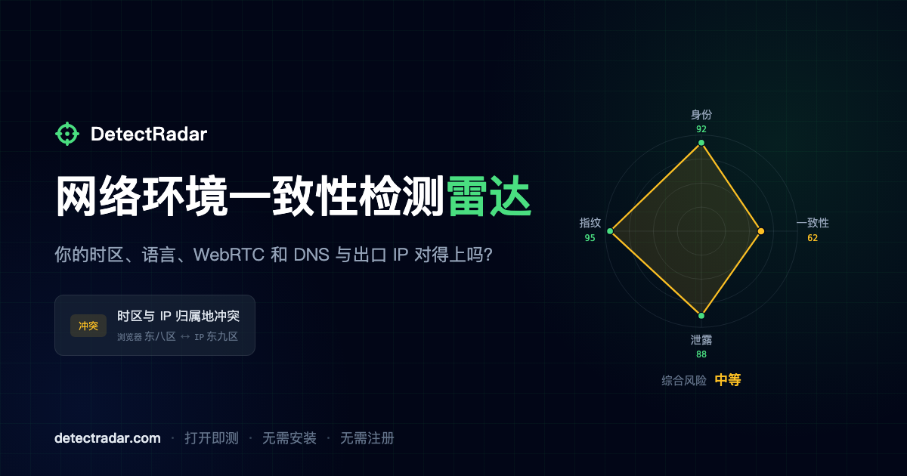

# DetectRadar

**免费、免注册的网络环境一致性与代理泄露检测工具。** 核对当前出口 IP（普通宽带 / 机房）、浏览器时区与语言一致性，检查 DNS、WebRTC 与 IPv6 泄露及浏览器指纹，生成可对比、可分享的诊断报告。

[在线体验](https://detectradar.com/) · [DNS 泄露](https://detectradar.com/dns-leak-test/) · [WebRTC 泄露](https://detectradar.com/webrtc-leak-test/) · [IPv6 泄露](https://detectradar.com/ipv6-leak-test/) · [macOS 版](https://detectradar.com/macos/) · [检测说明](https://detectradar.com/about/) · [隐私政策](https://detectradar.com/privacy/)



## 核心功能

- **综合环境检测（严格模式 / 日常模式）**：核对出口 IP 归属地、ASN、运营商、住宅/机房属性、Cloudflare Radar 近 30 天网段人类流量占比、公开黑名单与代理端口，并比对浏览器时区、语言及 Canvas / Audio / WebGL 指纹与自动化标记。
- **三大独立泄露专项页**：自建权威 DNS（CoreDNS + DNSTap）检测、WebRTC 本地 STUN 候选归属核对、独立纯 IPv4 / IPv6（`4.` / `6.`）双栈旁路检测，同浏览器自动保留最近两次结果方便改配置后对比。
- **终端与 AI 助手自检**：终端直接运行 `curl -s https://detectradar.com` 查看纯文本出口摘要，或将 [`SKILL.md`](https://detectradar.com/SKILL.md) 提供给 Claude Code / Codex / Antigravity 自动排查终端网络。
- **桌面与代理客户端伴侣**：提供原生 macOS 状态栏应用 [DetectRadarBar](macos/README.md) 以及 [Surge / Stash / Loon 面板模块](modules/README.md)。
- **脱敏分享**：支持一键复制文字摘要或本地生成 Canvas 分享图，自动对完整 IP 打码。

## 能力边界与隐私

- 仅观测发起请求的当前连接，不支持查询任意第三方 IP。
- “未见明显异常”仅表示本次各项信号自洽且未发现泄露，不保证目标网站不会风控；本站不提供代理或改指纹服务。
- 绘图、音频、渲染结果与扩展列表均在浏览器本地计算不可逆哈希后上传，分享图在本地生成；详见[检测说明](https://detectradar.com/about/)与[隐私政策](https://detectradar.com/privacy/)。

## 项目结构

| 目录 | 说明 |
| --- | --- |
| `client/` | Astro 5 + Svelte 5 + Tailwind CSS v4 静态前端 |
| `server/` | Go + Fiber 后端，负责出口 IP 识别、一致性评估、泄露复核与评分 |
| `cloud-ip-crawler/` | 云厂商与机房 IP 段抓取工具，生成 `hosting.db` 与 MMDB，见 [cloud-ip-crawler/README.md](cloud-ip-crawler/README.md) |
| `macos/` | 原生 Swift 6 + AppKit macOS 顶部状态栏伴侣（DetectRadarBar），见 [macos/README.md](macos/README.md) |
| `modules/` | Surge / Stash / Loon 代理面板模块，见 [modules/README.md](modules/README.md) |
| `deploy/` | Docker Compose、Nginx 与 CoreDNS 部署模板，见 [deploy/README.md](deploy/README.md) |

## 快速开始

### 终端快速查看当前出口

```bash
curl -s https://detectradar.com
curl -s https://4.detectradar.com
curl -s https://6.detectradar.com
```

### Docker 自托管部署

准备一台公网 Linux 服务器，放行 TCP `80`、`443` 与 TCP/UDP `53` 端口；域名托管在 Cloudflare（关闭橙云 Proxy），准备具备 `Zone DNS Edit` 和 `Zone Read` 权限的 API 令牌（`CF_Token`）：

```bash
mkdir detect-radar && cd detect-radar
curl -fsSLO https://raw.githubusercontent.com/harrisonwang/detect-radar/main/deploy/docker-compose.yml
curl -fsSL https://raw.githubusercontent.com/harrisonwang/detect-radar/main/deploy/.env.example -o .env

chmod 600 .env
vi .env    # 填写 DOMAIN、CF_Token 和 ACME_EMAIL
docker compose up -d
```

详细维护与排查见 [deploy/README.md](deploy/README.md)；反馈邮件通知等可选配置见 [server/configs/config.yaml.example](server/configs/config.yaml.example)。

### 本地开发

后端运行前需在 `server/data/` 准备地理/ASN 与机房数据库：

```bash
# 后端
cd server && cp configs/config.yaml.example configs/config.yaml && make run

# 前端（另开终端，默认调用 http://127.0.0.1:8080，可用 PUBLIC_API_BASE 覆盖）
cd client && npm install && npm run dev
```

## License

[MIT](LICENSE)
